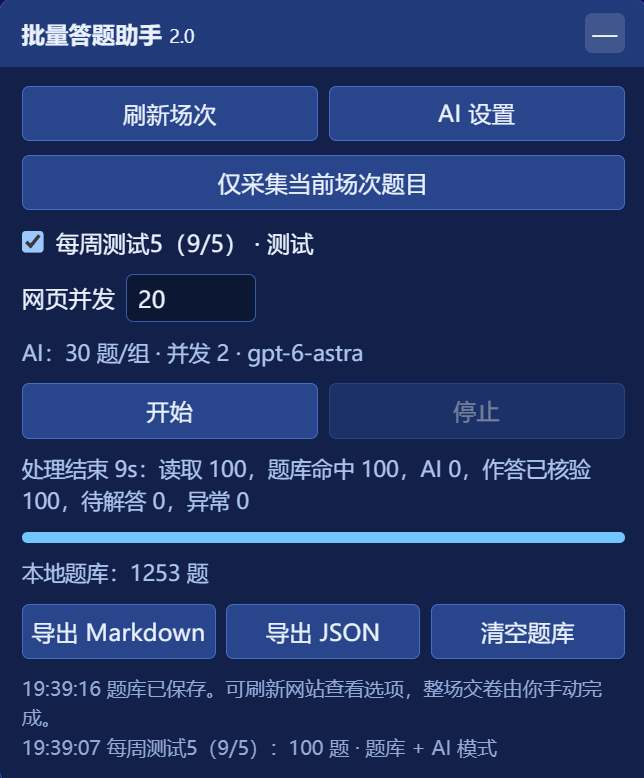
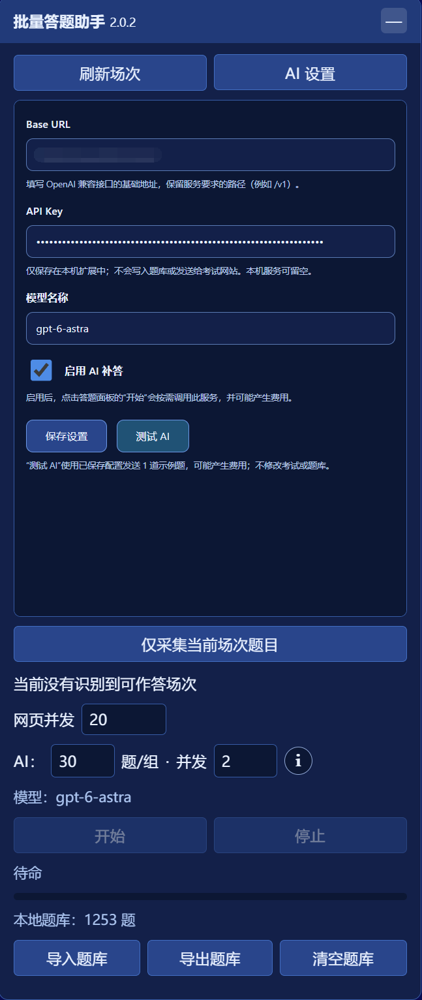

<div align="center">

# 模拟训练批量答题助手

**题库优先 · AI 补答 · 保存回读核验**

面向 `exam.asname.cn` 的 Chrome / Edge 扩展。<br>自动识别开放场次，复用已有答案，将题目与答案持续整理为本地题库。

<p>
  <a href="manifest.json"></a>
  <a href="#安装"></a>
  <a href="LICENSE"></a>
</p>

**[下载扩展](https://github.com/Meridian-lIzix/exam-asname-autofill/raw/refs/heads/main/exam-asname-autofill.zip)** · **[下载 JSON 题库](https://github.com/Meridian-lIzix/exam-asname-autofill/raw/refs/heads/main/question-bank/题库-2026-09-06.json)** · **[阅读题库](question-bank/题库-2026-09-06.md)**

[快速开始](#安装) · [使用指南](#使用) · [AI 设置](#ai-设置) · [API 兼容性](#api-兼容性说明) · [常见问题](#常见问题)

</div>

---

| 能力 | 处理方式 |
| --- | --- |
| **场次识别** | 自动识别当前开放的知识练习和测试，勾选后开始。 |
| **答案复用** | 按网站官方答案 → 本地题库 → AI 补答的顺序处理。 |
| **结果核验** | 保存选项后回读网站状态，标记作答是否核验成功。 |
| **题库积累** | 跨场次保存、匹配与合并，支持 Markdown / JSON 导出。 |

## 安装

1. **下载并解压**：[获取安装包](https://github.com/Meridian-lIzix/exam-asname-autofill/raw/refs/heads/main/exam-asname-autofill.zip)，解压到固定位置。
2. **加载扩展**：打开浏览器扩展页，启用「开发者模式」，点击「加载已解压的扩展程序」，选择解压出的 `exam-asname-autofill` 文件夹本身。
3. **登录网站**：打开 [exam.asname.cn](https://exam.asname.cn/) 并登录，页面右下角会出现助手面板。

| 浏览器 | 在地址栏输入 |
| --- | --- |
| Chrome | `chrome://extensions/` |
| Edge | `edge://extensions/` |

> [!TIP]
> 初次使用建议先[下载 JSON 题库](https://github.com/Meridian-lIzix/exam-asname-autofill/raw/refs/heads/main/question-bank/题库-2026-09-06.json)，再通过面板底部的「导入题库」加载已有答案。已有题库会自动合并，无需清空。

加载后请保留扩展所在文件夹。更新时，在扩展管理页**重新加载扩展，再刷新考试网页**。

## 共享题库

仓库的 [`question-bank/`](question-bank/) 提供同一批题目的阅读版和导入版：**1291 题**，更新于 **2026-09-06**，其中 **38 题标注为 AI 作答**。

| 格式 | 用途 | 获取方式 |
| --- | --- | --- |
| **JSON** | 导入扩展，参与答案匹配 | [下载可导入题库](https://github.com/Meridian-lIzix/exam-asname-autofill/raw/refs/heads/main/question-bank/题库-2026-09-06.json) |
| **Markdown** | 在线阅读与复习 | [阅读最新题库](question-bank/题库-2026-09-06.md) |

两种格式的题目、选项和答案已逐项核对一致，保留 AI 作答标记。**Markdown 不能直接导入扩展。** 未覆盖的新题继续按题库与 AI 补答流程处理；题库内容以标注的导出日期为准。

## 使用

1. **刷新场次**：登录后点击「刷新场次」，勾选要处理的场次。列表每 30 秒自动刷新，开始前会再次核实可作答状态。
2. **调整参数**：按需设置[网页并发、AI 每组题数和并发组数](#并发与分组)。需要 AI 补答时，先完成 [AI 设置](#ai-设置)。
3. **开始处理**：点击「开始」。优先使用已知答案；测试中缺少答案的题，启用 AI 后才发送给模型。未启用 AI 或调用失败的题保留为待解答。
4. **查看结果**：处理结束后手动刷新网页查看作答，最终交卷由你完成。

> [!NOTE]
> 「作答已核验」表示网站保存了预期选项。测试不返回官方答案时，这项核验不能证明答案正确。扩展不会自动最终交卷。

点击「停止」会停止派发新任务并取消 AI 请求，已获得的答案保留；重新运行会优先复用题库。请勿在多个页面同时开始答题。

<details>
<summary><strong>查看实际运行截图</strong> · 100 题全部命中题库</summary>

下图来自 2.0 版本的一次实际运行：读取 100 题，全部命中题库，AI 调用题数为 0。当前版本已更新统计项和底部按钮布局。

<p align="center">
  
</p>

</details>

<details>
<summary><strong>查看统计口径</strong> · 网站答案、题库命中、AI 与核验</summary>

| 统计项 | 含义 |
| --- | --- |
| 网站答案 | 本轮由网站返回的官方答案数量。 |
| 题库命中 | 复用以前保存到本场次的答案，或从其他场次匹配到的答案。 |
| AI | 本轮新获取的 AI 答案数量。 |
| 作答已核验 | 网站保存状态已回读并核对。 |

重复运行时，复用已保存的 AI 答案也计入「题库命中」，不计为本轮新获取的 AI 答案。

</details>

## 并发与分组

| 设置 | 默认值 | 可选范围 | 作用 |
| --- | ---: | ---: | --- |
| **网页并发** | 5 | 1～20 | 同时读取题目、保存选项和回读核验的网站请求数。 |
| **AI 题/组** | 30 | 1～100 | 每次 AI 请求最多包含的题目数。 |
| **AI 并发** | 2 | 1～10 | 同时发送给 AI 的题目组数。 |

**最多同时处理题数 = 每组题数 × AI 并发组数。** 例如 40 题/组、并发 2，最多同时处理 80 题；其余题目自动排队，一组完成后立即接续。整场题数不受这个乘积限制，网页并发也不会改变 AI 并发。

AI 两项参数修改后自动保存，运行期间不可修改。鼠标悬停或用键盘聚焦旁边的「i」，可以查看说明。

- **起步配置**：30 题/组、并发 2。
- **长题或输出不完整**：降低每组题数。
- **服务限流**：降低 AI 并发。

## AI 设置

在面板中打开「AI 设置」，配置服务并保存，允许扩展访问对应服务域名，再点击「测试 AI」。

| 配置项 | 填写说明 |
| --- | --- |
| **Base URL** | OpenAI Chat Completions 兼容服务的基础地址，保留服务要求的路径，例如 `https://api.example.com/v1`。 |
| **API Key** | 填写该服务的有效密钥；本机服务可以留空。 |
| **模型名称** | 使用该服务实际提供的模型 ID。 |
| **启用 AI 补答** | 勾选后，开始处理时才会为缺少答案的题调用 AI。 |

远程接口必须使用 HTTPS；本机 `localhost` / `127.0.0.1` 服务可以使用 HTTP。保存设置和「测试 AI」不受考试开放时间限制，也可以从扩展管理页打开设置页操作。

「测试 AI」使用**已保存配置发送 1 道固定示例题**，核对接口、返回题号和选项格式，并显示模型及耗时。测试可能产生少量调用费用，不修改考试或题库；即使所有题目都命中题库，也能单独测试 AI。

<details>
<summary><strong>查看配置面板截图</strong> · 服务设置、分组与导入导出</summary>

下图为 2.0.2 配置面板，服务地址已遮挡，API Key 以密码形式显示。

<p align="center">
  
</p>

</details>

<details>
<summary><strong>数据发送与答案校验</strong></summary>

- 配置保存在本机扩展存储。密钥通过独立的扩展设置页输入，不进入网站存储或题库导出。
- 启用 AI 后，仅向所配置服务发送待解答题目的题号、题型、题干和选项，调用可能产生费用。
- 模型按题号返回 JSON，扩展校验题号、选项范围和单多选数量，再按选项内容对应网站当前顺序。乱序返回不会按位置串题。
- 漏题或非法答案会重试一次，仍失败的题保持待解答。格式正确不保证模型知识判断正确。

</details>

### API 兼容性说明

本扩展以 **OpenAI Chat Completions 兼容接口**为对接标准。不同服务商、模型及中转网关对 `system` 消息、结构化输出参数、流式响应和返回字段的实现可能存在差异。因此，声明兼容该接口的服务，仍可能需要依据其接口文档，对请求参数、提示词或响应解析逻辑进行针对性适配。

2.0.3 在 `system` 和 `user` 消息中同时提供答题任务与 JSON 格式要求，以增强输出格式的稳定性。已使用一个实际服务的 `claude-opus-5` 验证单题连接测试和一组 30 道单选、多选、判断题；**该验证仅覆盖当时的服务、模型及配置**，不代表其他 API 已通过兼容性验证。

接入新服务或更换模型、接口版本后，请先运行「测试 AI」。若出现 JSON 不完整、缺少答案字段等错误，应结合具体服务的返回格式排查并适配。扩展仅使用通过格式、题号及选项校验的答案；通过示例题测试也不保证真实题目的答案正确。

## 题库与采集

| 操作 | 结果 |
| --- | --- |
| **导入题库** | 选择本扩展导出的 JSON 文件，兼容旧版题库，自动合并去重。 |
| **导出题库** | 在按钮正上方的菜单选择 Markdown 复习资料，或可再次导入的 JSON。 |
| **清空题库** | 清空本地积累；操作前请先导出需要保留的资料。 |
| **仅采集当前场次题目** | 下载当前场次的独立诊断 JSON，并在浏览器保留一份采集记录；不作答、不调用 AI。 |

<details>
<summary><strong>题库合并与答案保存规则</strong></summary>

- 题型、题干及选项内容相同的题目只保留一条，选项换序不影响去重或匹配，作答时按当前选项重新对应。
- 官方答案优先于 AI 答案，未解答记录不会覆盖已有答案。文件格式错误或同一题存在同等来源的答案冲突时，停止导入并保留原题库。
- 题库沿用网站原有的 `localStorage` 存储，跨场次、跨多次运行累积。
- AI 来源在导出题干末尾标注 `（AI作答）`，原始题干用于匹配。AI 答案即使提交失败也会保留，并记录作答是否核验成功。

</details>

采集文件名为 `场次采集-…json`，用于核对网站真实数据结构，与普通「导出 JSON」的历史题库不同。仅能在对应场次仍可访问时采集当前页面的场次和题目。

## 常见问题

<details>
<summary><strong>为什么没有识别到可作答场次？</strong></summary>

列表只显示接口实际返回、当前开放、尚未交卷且能识别的选择题场次。过期、未开放、已交卷及无法识别的场次不显示。先确认已登录，再点击「刷新场次」。

</details>

<details>
<summary><strong>出现「未找到登录凭证」怎么办？</strong></summary>

登录后刷新考试网页，再使用面板。

</details>

<details>
<summary><strong>更新后仍提示后台是旧版本，怎么办？</strong></summary>

先在扩展管理页重新加载扩展，再刷新考试网页。仅刷新网页不会更新已运行的后台。

</details>

<details>
<summary><strong>更换 AI 服务后，为什么会提示 JSON 格式错误？</strong></summary>

不同服务可能采用不同的输出格式或参数实现，需先使用「测试 AI」验证当前配置，必要时按具体服务适配。参见 [API 兼容性说明](#api-兼容性说明)。

</details>

## 练习与测试的区别

<details>
<summary><strong>展开查看答题策略与网站凭证处理</strong></summary>

已识别的知识练习继续使用原有流程：读取题目，对未答题作答后重新读取 `r_answer`，再校正答案。

测试不会通过随便选择一个选项来探测答案；官方答案缺失时先查题库，再按需调用 AI。场次模式结合接口返回的名称、分组信息、类型及开放时间识别，不只根据页面 URL 判断。

网站登录凭证在请求时从 `sessionStorage` 读取，仅用于原站接口，不发送给 AI 服务。扩展不会调用最终交卷接口。

</details>

## 开发验证

扩展运行**不依赖第三方库，无需构建**，可直接作为已解压扩展加载。

<details>
<summary><strong>查看测试命令与可选验证依赖</strong></summary>

安装 Node.js 后，运行：

```sh
node --test tests/*.test.cjs
```

覆盖场次过滤、题库匹配、AI 分组与响应校验、后台权限及提交回读逻辑。

| 脚本 | 验证范围 |
| --- | --- |
| `tests/browser-flows.cjs` | 模拟页面、场次、分组及作答流程。 |
| `tests/settings-flow.cjs` | 设置保存、服务域名权限及连接测试流程。 |
| `tests/import-flows.cjs` | 题库导入、合并及导出交互。 |

这三个模拟页面脚本需另行安装开发验证依赖 `jsdom`，可安装到独立目录，再通过 `NODE_PATH` 指定并用 Node.js 运行，不影响扩展安装包。

模拟测试不等同于真实服务验证，首次配置 AI 后应检查实际调用结果。

</details>

## 许可

[MIT](LICENSE) · 仅供学习用途。
